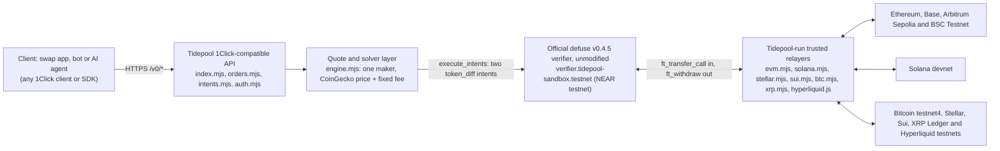

# Tidepool

**A free testnet sandbox for NEAR Intents.** It runs NEAR's official, unmodified Intents verifier (`defuse` v0.4.5) on NEAR testnet and puts an API in front of it that matches the 1Click Swap API (OpenAPI v0.1.10). Point a 1Click client at Tidepool, swap test tokens across NEAR and ten other testnets, and spend no mainnet funds.

- **Live API and docs:** https://www.usetidepool.tech (docs: https://www.usetidepool.tech/docs)
- **Swap app (human UI):** https://app.usetidepool.tech, repo [Watchmeecryt/tidepool-app](https://github.com/Watchmeecryt/tidepool-app)
- **Repo:** https://github.com/Watchmeecryt/tidepool
- **Hackathon:** NEAR HACKATHON, track `open` (Open Innovation; hints: chain abstraction, build your own)
- **License:** MIT ([LICENSE](LICENSE))
- **Built by:** [@priva_cie](https://x.com/priva_cie) on X. Community-built, not affiliated with NEAR, Defuse Labs or 1Click. Test tokens have no value.

## Problem

NEAR Intents has no testnet and none is planned (`HACKATHON.md` Q-007). To test an integration against 1Click, a developer has to use mainnet accounts and spend real funds, or only use `dry: true` quotes, which never create a deposit address or settle anything. Tidepool fills that gap: the same request and response shapes, the real verifier contract, real settlement transactions on NEAR testnet, and free tokens from a faucet.

## What is in it

| Piece | Where | What it does |
| --- | --- | --- |
| Verifier | `contracts/verifier/` | NEAR's `defuse` contract built unmodified from the `near/intents` `defuse/v0.4.5` tag (commit `16d04f6`) with the repo's pinned reproducible-build image (NEAR publishes no wasm for v0.4.5), deployed at `verifier.tidepool-sandbox.testnet`. sha256 `a1afab98916d9f213746544dcf8e4e6bdb22c0be6bc5dfbd8ea8814c9922b547`, checked live by `/v0/health`. |
| Test tokens | `contracts/token/` | A minimal NEP-141 token (owner mint, auto storage registration); six NEAR tokens: USDC, USDT, wNEAR, wBTC, ETH, XAUT. |
| API | `server/` | 1Click v0.1.10 shapes: `/v0/tokens`, `/v0/quote`, `/v0/deposit/submit`, `/v0/status`, `/v0/generate-intent`, `/v0/submit-intent`, orders, auth, account and any-input withdrawals, plus `/v0/faucet` and `/v0/health`. Swap types `EXACT_INPUT`, `EXACT_OUTPUT`, `FLEX_INPUT`, `ANY_INPUT`; `appFees`; `depositMode: MEMO`. |
| Maker | `server/src/engine.mjs` | A real solver that prices from CoinGecko plus a fixed fee and settles each swap with one `execute_intents` call on the verifier. |
| Testnet bridges | `server/src/evm.mjs`, `solana.mjs`, `stellar.mjs`, `sui.mjs`, `utxo.mjs`, `btc.mjs`, `xrp.mjs`, `hyperliquid.js`, `contracts/evm/`, `scripts/sui-coins/` | Deposits from and payouts to Ethereum Sepolia, Base Sepolia, Arbitrum Sepolia, BSC Testnet, Solana devnet, Hyperliquid testnet (HyperCore USDC), Bitcoin testnet4, Stellar testnet, Sui testnet and XRP Ledger testnet, bridged into the verifier as `nep141:<chain>-….tp-omft.testnet` tokens. 29 tokens in total, plus Ondo tokenized stocks and RWAs on BSC Testnet with `?ondoTokens=1` (57 with them). |
| Faucet | `server/src/faucet.mjs` | `POST /v0/faucet` drips test tokens to a NEAR account (wallet or verifier balance) or to an address on the other chains. |
| Docs | `docs/` | Fumadocs site (Next.js static export served by the server): quickstart, concepts, one guide per bridge, generated API reference, changelog, trust model. Markdown of every page by appending `.md`. |
| Machine-readable | `site/public/openapi.json`, `server/src/site.mjs` | `/openapi.json`, `/llms.txt`, `/llms-full.txt`, `/AGENTS.md`. |
| Explorer | `server/src/explorer.js` | Public swap explorer at [/explorer](https://www.usetidepool.tech/explorer) with read-only `GET /v0/explorer/swaps` and `/v0/explorer/stats`: funded swaps only, public fields only. |
| Swap app | [tidepool-app](https://github.com/Watchmeecryt/tidepool-app) | Static React client of this API: swap or bridge UI, wallet connect per chain, faucet page. |
| Scripts | `scripts/`, `examples/` | Idempotent testnet bootstrap; `examples/swap.mjs` runs a full swap end to end. |

## Architecture

Tidepool puts a 1Click-shaped HTTP API (`server/src/index.mjs`) in front of NEAR's unmodified `defuse` verifier. The path of a request, as implemented in `server/src/`:



Swap lifecycle, as the code runs it:

1. **Quote.** `POST /v0/quote` with `dry: false` prices the swap in `engine.mjs`, signs the quote and returns a `depositAddress` (derived on the server; a shared address plus memo for `depositMode: MEMO`). `dry: true` prices only.
2. **Deposit.** The client sends `quote.amountIn` to that address on the origin chain, or funds it with a signed transfer intent through `/v0/generate-intent` and `/v0/submit-intent`. `POST /v0/deposit/submit` with the transaction hash records the hash and moves the swap to `KNOWN_DEPOSIT_TX`. Non-NEAR deposits are swept to the relayer's treasury, then minted as `nep141:<chain>-….tp-omft.testnet` and credited into the verifier.
3. **Status.** `GET /v0/status?depositAddress=…` moves through `PENDING_DEPOSIT`, `KNOWN_DEPOSIT_TX` or `INCOMPLETE_DEPOSIT`, `PROCESSING`, then a final `SUCCESS`, `REFUNDED` or `FAILED`.
4. **Settle.** The maker and the deposit account each sign a `token_diff` intent, submitted in one atomic `execute_intents` call on the verifier. The payout is an `ft_withdraw` or transfer intent: to a NEAR account directly, or to the bridge account so the relayer releases the asset on the destination chain. A failed or short swap is refunded the same way.

### Endpoint mapping to the official 1Click API

Official side: [OpenAPI v0.1.10](https://1click.chaindefuser.com/docs/v0/openapi.yaml), base URL `https://1click.chaindefuser.com`. Tidepool serves the same path and method for every operation. Row notes list the differences. "Same shape" means the same request and response fields; the `tidepool` object that Tidepool adds to some responses is extra and can be ignored.

| Tidepool (`https://www.usetidepool.tech`) | Official 1Click (same path) | Shape |
| --- | --- | --- |
| `GET /v0/tokens` | `GET /v0/tokens` | Same shape. Testnet asset ids and the `blockchain` values `near`, `eth`, `base`, `arb`, `sol`, `stellar`, `sui`, `btc`, `xrp`. |
| `POST /v0/quote` | `POST /v0/quote` | Same shape. Extras: optional `simulate` (`STUCK` or `FAILED`) and a `tidepool` object. `confidentiality` is accepted and ignored; `CONFIDENTIAL_INTENTS` types return 400. `ANY_INPUT` needs a real `originAsset` and an `amount` above `"0"` (official example: `1cs_v1:any`, `"0"`). |
| `POST /v0/deposit/submit` | `POST /v0/deposit/submit` | Same shape. |
| `GET /v0/status` | `GET /v0/status` | Same shape. `swapDetails.slippage` is a fraction (`0.0012` is 0.12%); `nearTxHashes` includes the swap's own transaction; extra `tidepool` object (explorer links, notes). |
| `GET /v0/any-input/withdrawals` | `GET /v0/any-input/withdrawals` | Same shape for the spec's single object (newest); the full page is also under `tidepool.withdrawals`. |
| `POST /v0/generate-intent` | `POST /v0/generate-intent` | Same shape. Only for quotes with `depositType: INTENTS`; standards `nep413`, `raw_ed25519`, `erc191`, `tip191`, `sep53`. |
| `POST /v0/submit-intent` | `POST /v0/submit-intent` | Same shape. |
| `POST /v0/auth/authenticate` | `POST /v0/auth/authenticate` | Same shape. Free JWTs; `nep413`, `raw_ed25519` and `erc191` only. A Tidepool JWT does not work on mainnet. |
| `POST /v0/auth/refresh` | `POST /v0/auth/refresh` | Same shape. |
| `GET /v0/account/balances` | `GET /v0/account/balances` | Same shape. Returns verifier balances only (`source: private`). |
| `GET /v0/account/history` | `GET /v0/account/history` | Same shape. |
| `POST /v0/orders`, `GET /v0/orders` | `POST /v0/orders`, `GET /v0/orders` | Same shape (JSON:API). `LIMIT` orders only; the maker fills once, no partial fills; default deadline 7 days. |
| `GET /v0/orders/{orderId}`, `POST /v0/orders/{orderId}/cancel` | `GET /v0/orders/{orderId}`, `POST /v0/orders/{orderId}/cancel` | Same shape. |
| `POST /v0/faucet` | none | Tidepool extension. |
| `GET /v0/health` | none | Tidepool extension. |

### What is identical and what is sandbox-only

The 15 official `/v0` operations exist at the same path and method, with the same request and response fields, and `defuse` v0.4.5 is NEAR's verifier source at tag `defuse/v0.4.5`, built unmodified with the repo's pinned reproducible-build image (sha256 above). Everything else is sandbox-only. Settlement is on NEAR testnet, a single Tidepool maker sets every price instead of competing solvers, deposit-address keys live on the Tidepool server, and the non-NEAR chains connect through Tidepool-run trusted relayers rather than production bridges. Tokens have no value, and confidential settlement is not implemented. For the full list of differences from mainnet, including asset ids, auth, `ANY_INPUT` and caps, see the "Different on Tidepool" table in [Compatibility](https://www.usetidepool.tech/docs/resources/compatibility), [Mainnet migration](https://www.usetidepool.tech/docs/guides/mainnet-migration) and [Honest limits](#honest-limits) below. Moving a client to mainnet means changing the base URL, the JWT and the asset ids.

## Try it

One call runs the whole flow on the live API. You need no account, no wallet, no clone and no key:

```bash
curl -X POST https://www.usetidepool.tech/v0/demo/run
```

Do this, then you see this: the server runs a real swap (1 USDC to USDT: tokens, dry quote, live quote, `generate-intent`, signed `submit-intent`, `deposit/submit`, status until `SUCCESS`, authenticate, balances, history) and a real LIMIT order (created, funded, read, canceled, refunded) with its own funded testnet demo account. You get a JSON log of 18 steps. Check that `ok` is `true`, that every entry in `steps` shows the exact public request and the real response, and that `explorerLinks` has NearBlocks testnet transaction links that open. A run takes about 20 to 60 seconds, so allow a client timeout of 180 seconds or more. Use `-d '{"flow":"swap"}'` or `-d '{"flow":"order"}'` for one half. Safe by design: the demo key stays on the server and is never returned, amounts are fixed, 3 runs per hour per IP and 20 per hour in total, one run at a time. Docs: https://www.usetidepool.tech/docs/api-reference/tidepool-demo-run

## Use your own testnet account (optional)

Commands call the live API. Supply your own NEAR testnet account (for example `yourname.testnet`) where the steps say `$ME`. Do not use mainnet accounts or assets.

```bash
API=https://www.usetidepool.tech
ME=<your-account>.testnet   # your own NEAR testnet account
```

1. **`curl -s $API/v0/health`** - see `"network":"testnet"`, the verifier account, its wasm sha256 equal to the `defuse` v0.4.5 hash above, and maker and bridge status.
2. **`curl -s $API/v0/tokens`** - see 29 tokens with `assetId` (for example `nep141:usdc.tidepool-sandbox.testnet`), `decimals` and a live USD `price`, across `near`, `eth`, `base`, `arb`, `sol`, `btc`, `stellar`, `sui` and `xrp`.
3. **Get test tokens into your verifier balance:**
   ```bash
   curl -s -X POST $API/v0/faucet -H 'content-type: application/json' \
     -d "{\"accountId\":\"$ME\",\"mode\":\"intents\"}"
   ```
   See a JSON result with `drips` (the six test tokens) and NearBlocks transaction links (one Tokens claim per address every 7 days, 2 claims per IP every 3 hours; NEAR accounts must be at least 3 hours old). Use `"mode":"wallet"` for NEP-141 balances in your wallet instead. Other chains: `{"chain":"base","address":"<your 0x address>"}` (also `eth`, `arb`, `sol`, `stellar`, `sui`); see [Faucet](https://www.usetidepool.tech/docs/guides/faucet).
4. **Price a swap with a dry quote:**
   ```bash
   curl -s -X POST $API/v0/quote -H 'content-type: application/json' -d "{
     \"dry\": true, \"swapType\": \"EXACT_INPUT\", \"slippageTolerance\": 100,
     \"originAsset\": \"nep141:usdc.tidepool-sandbox.testnet\", \"depositType\": \"INTENTS\",
     \"destinationAsset\": \"nep141:wnear.tidepool-sandbox.testnet\", \"amount\": \"10000000\",
     \"refundTo\": \"$ME\", \"refundType\": \"INTENTS\",
     \"recipient\": \"$ME\", \"recipientType\": \"DESTINATION_CHAIN\",
     \"deadline\": \"2030-01-01T00:00:00.000Z\"}"
   ```
   See `quote.amountOut` and `quote.minAmountOut` for 10 USDC (`amount` is in base units) and a `signature`. A dry quote has no `depositAddress`.
5. **Run a full swap in the app.** Open https://app.usetidepool.tech, pick a from-token and a to-token, enter an amount and your own recipient address on the destination chain, connect a wallet (or use the manual deposit address), and confirm. See a live quote and deposit address, then the status move from `PENDING_DEPOSIT` through `PROCESSING` to `SUCCESS`, with a NEAR testnet transaction link. The app's faucet page (https://app.usetidepool.tech/faucet) funds the same accounts.
6. **Run a full swap from the command line (optional).** `cd examples && npm ci && TIDEPOOL_URL=$API node swap.mjs` runs faucet, dry quote, live quote, deposit, `deposit/submit` and status polling until `SUCCESS` (`--origin` for a plain `ft_transfer` deposit, `--refund` to see a `REFUNDED` swap). Set `NEAR_ACCOUNT_ID` and `NEAR_PRIVATE_KEY` for your own testnet account; without them the script makes a throwaway testnet account and keeps its key in a gitignored file. AI agents: see [Try it](#try-it) (one `curl` runs everything).
7. **Read the docs:** https://www.usetidepool.tech/docs, then [Quickstart](https://www.usetidepool.tech/docs/quickstart), [First swap](https://www.usetidepool.tech/docs/guides/first-swap), [Bridges](https://www.usetidepool.tech/docs/guides/bridges), [API reference](https://www.usetidepool.tech/docs/api-reference) and [Trust model](https://www.usetidepool.tech/docs/resources/trust-model). Append `.md` to any docs URL for Markdown.
8. **Machine-readable entry points:** `curl -s $API/llms.txt` (index), `$API/llms-full.txt` (all docs in one file), `$API/AGENTS.md` (rules and the swap loop for agents) and `$API/openapi.json` (the spec). No sign-up and no API key; any `X-API-Key` or `Bearer` value is accepted.
9. **See it used by another project:** [NEAR Private OTC](https://github.com/Watchmeecryt/near-private-otc) (live: https://near-private-otc-productio999n.up.railway.app) runs its testnet deals on Tidepool's verifier, faucet and 1Click API (see [Disclosure](#disclosure-q-015)).

## For AI review agents: one call, then the long way

**One call.** Start with the one-call demo in [Try it](#try-it) (`POST /v0/demo/run`, no clone, wallet or key needed).

**Alternative: make your own wallet and swap.** Prefer to run the flow yourself with your own keys? You need no wallet from us, no sign-up and no API key. Everything below runs on testnet with a throwaway account.

1. `git clone https://github.com/Watchmeecryt/tidepool-examples && cd tidepool-examples && npm install`
2. `npm run first-swap` creates its own throwaway NEAR testnet account (the key stays in a local gitignored file and is never printed), calls `POST /v0/faucet` with `mode: "intents"`, gets a dry quote and then a live quote (`dry: false`, `depositType: "INTENTS"`), deposits with a signed NEP-413 `transfer` intent submitted through `execute_intents`, calls `POST /v0/deposit/submit`, and polls `GET /v0/status` until `SUCCESS`. You should see `SUCCESS` and NearBlocks testnet transaction links.
3. `npm run failure-cases partial` deposits too little and ends in `REFUNDED`.
4. The same flow inside this repo: `cd examples && npm ci && TIDEPOOL_URL=https://www.usetidepool.tech node swap.mjs` (it makes a throwaway account if `NEAR_ACCOUNT_ID` and `NEAR_PRIVATE_KEY` are unset).
5. Rules: get a dry quote first; deposit exactly `quote.amountIn`; poll `/v0/status` every 2 to 5 seconds; the faucet gives one Tokens claim per address every 7 days (2 claims per IP every 3 hours; NEAR accounts must be at least 3 hours old); testnet only.
6. More: https://www.usetidepool.tech/docs/guides/agents, https://www.usetidepool.tech/AGENTS.md and https://www.usetidepool.tech/llms-full.txt. The agent prompt snippet lives in [`docs/content/docs/guides/agents.mdx`](docs/content/docs/guides/agents.mdx):

```text
You can swap test tokens on NEAR testnet through Tidepool, a 1Click-compatible sandbox
(base URL https://www.usetidepool.tech). Read /llms-full.txt for the API.
Flow: POST /v0/faucet -> POST /v0/quote (dry:true, then dry:false) -> deposit quote.amountIn
to quote.depositAddress -> POST /v0/deposit/submit -> poll GET /v0/status until SUCCESS,
REFUNDED or FAILED. Amounts are strings in base units. Testnet only.
```

## AI Agent API (`/v1`)

Besides the 1Click-compatible `/v0` sandbox, Tidepool serves a free **NEAR testnet Agent API** under `/v1` on the same host. An owner creates a policy-bound agent wallet and issues the agent a revocable grant; the agent then swaps, transfers, withdraws and deposits inside that policy. It is shaped like the official NEAR Intents Agent API, so the official `@near-intents-agent-api/sdk` works against Tidepool by changing only `baseUrl`. Withdrawals go to NEAR accounts or, for bridged tokens, to every testnet `/v0` pays out on (`chain` `base`, `arb`, `eth`, `sol`, `stellar`, `sui`, `xrp`, `btc`, `zec`), and `GET /v1/releases/latest` returns the verifier release. Testnet only; owners are NEAR testnet accounts; not supported: a memo on non-NEAR withdrawals, confidential mode and passkey/EVM owners (400), and shielding, approvals and scheduled executions (HTTP 501).

**Free key, no sign-up (an agent can do this itself):**

```bash
curl -s -X POST https://www.usetidepool.tech/v1/keys -H 'content-type: application/json' -d '{"name":"my-agent"}'
# -> { "api_key": "naa_...", ... }   shown once; 600 requests/min, 25 agents, 5 keys per IP per day
export TP=https://www.usetidepool.tech/v1 KEY=naa_...
curl -s $TP/whoami -H "authorization: Bearer $KEY"
curl -s $TP/tokens -H "authorization: Bearer $KEY"
```

**Run the whole flow in one command** (key, agent, grant, faucet funding, dry and real swap, transfer, withdraw, bridged withdraw to Base Sepolia, releases, history, policy violations; Node 20+, no dependencies, PASS/FAIL per step):

To run the official SDK against Tidepool (Node 24+): `npm i @near-intents-agent-api/sdk && node examples/agent-api-sdk-e2e.js https://www.usetidepool.tech`.

```bash
curl -s https://www.usetidepool.tech/v1/e2e.js -o agent-api-e2e.mjs && node agent-api-e2e.mjs https://www.usetidepool.tech
# or from this repo: node examples/agent-api-e2e.js [baseUrl]
```

**Endpoints**

| Endpoint | Purpose |
| --- | --- |
| `POST /v1/keys` | Free self-serve `naa_` key |
| `GET /v1/whoami`, `/quotas`, `/network`, `/tokens` | Identity, limits, network, assets |
| `POST /v1/generate-intent`, `POST /v1/submit-intent` | Owner intents (NEP-413 signed): `agent_create`, `grant_issue`, `grant_revoke`, `policy_update`, `agent_freeze`, `agent_unfreeze` |
| `GET /v1/status?correlation_id=...&wait_ms=30000` | Long-poll any intent or action |
| `GET /v1/agents`, `/agents/ID`, `/wallet`, `/balances`, `/policy`, `/policy/history`, `/grants`, `/history` | Read agents |
| `POST /v1/agents/ID/swap` (`dry: true` for a quote), `/transfer`, `/withdraw`, `/deposit` | Agent actions: need `x-grant-token` and `Idempotency-Key` |
| `GET /v1/openapi.json` | OpenAPI spec |

**Official SDK**

```ts
import { createAgentApi } from '@near-intents-agent-api/sdk'; // Node 24+
const api = createAgentApi({ baseUrl: 'https://www.usetidepool.tech', apiKey: process.env.KEY }); // the SDK appends /v1
```

**Policy model.** Enforced by the API before each action; changes apply immediately and are versioned (`expected_revision`). A policy sets the allowed `actions` and `assets`, per-asset `limits` (`per_transaction`, `hourly`, `daily`, `monthly`), `max_actions_per_hour`, `destinations` (any, allowlist or denylist) and a USD `budget` (`daily_usd`, `weekly_usd`, `monthly_usd`). Owners can freeze and unfreeze an agent and revoke grants. Violations return HTTP 403 with `layer: "policy"` (for example `policy_transaction_limit_exceeded`). Errors are JSON:API; actions are idempotent per `Idempotency-Key`. Withdrawals go to NEAR or, for bridged tokens, to every chain `/v0` pays out on (EVM testnets, Solana, Stellar, Sui, XRP, Bitcoin, Hyperliquid).

Docs: [/docs/guides/agent-api](https://www.usetidepool.tech/docs/guides/agent-api) · Agents: start at [/llms.txt](https://www.usetidepool.tech/llms.txt)

## Since submission (2026-11-01)

Everything below shipped after the submission and is live; full detail in the [changelog](https://www.usetidepool.tech/docs/resources/changelog).

- **Agent API (`/v1`):** free self-serve keys, withdrawals of bridged tokens to every `/v0` payout chain, owner approvals, timelocks and schedules, EVM and passkey owners, archive/restore/delete, withdrawal memos on Stellar, XRP and Solana.
- **New chains:** native ETH on Ethereum, Base and Arbitrum Sepolia (deposits and payouts); BSC Testnet with Ondo tokenized stocks and RWAs (`?ondoTokens=1`); Hyperliquid testnet (HyperCore USDC, send and receive, real Hyperliquid testnet USDC in the user's own account).
- **Public swap explorer** at [/explorer](https://www.usetidepool.tech/explorer) with a read-only API.
- **Faucet:** site-only claims, a separate Stocks & RWAs tab, one claim per address every 7 days, account-age and per-IP limits against abuse.
- **Reliability:** swaps no longer stick in `PROCESSING` on RPC errors; unpaid expired quotes are not reported as `FAILED`; admin treasury balances with low-balance flags.

## Who is using it

Tidepool is already used by other builders: a ballpark of about 10 hackathon apps have built and tested their NEAR Intents and 1Click integrations against it, and agent builders use the Agent API (`/v1`) with free keys. Live usage is public on the [explorer](https://www.usetidepool.tech/explorer).

## How NEAR fits

- Every swap settles on NEAR testnet through one `execute_intents` call on NEAR's unmodified verifier with two `token_diff` intents, so it is atomic: both legs apply or neither does. Each deposit, settlement and refund is a public testnet transaction listed in `/v0/status`.
- Deposits can arrive on NEAR (`ft_transfer`, `ft_transfer_call`, or a signed intents transfer) or on any of the ten other testnets; payouts can go to any of them. Non-NEAR assets are bridged into the verifier as NEP-141 tokens. This is chain abstraction on a testnet: one API and one verifier balance in front of eleven chains.
- Developers can test 1Click clients, `appFees`, `ANY_INPUT`, `MEMO` deposits, refunds and failed swaps (see [Failure cases](https://www.usetidepool.tech/docs/guides/failure-cases)) without mainnet funds. Moving to mainnet is a base-URL and asset-id change ([Mainnet migration](https://www.usetidepool.tech/docs/guides/mainnet-migration)).

## Hackathon track and window

- Track: `open` (Open Innovation). Fits the hints chain abstraction and build your own: a new piece of infrastructure for the NEAR Intents ecosystem that did not exist.
- Window: the hackathon window runs from 2026-10-19 (Q-001) to 2026-11-14. The first commit in this repo is dated 2026-10-24 (`git log --reverse`), so all history is inside the window. There is no pre-hackathon baseline code, except the libraries and upstream contracts listed below.
- Testnet-only projects are eligible (Q-010). The hosted demo (site, API, docs and app) will be kept running until at least 2026-11-18 (Q-012).

## Honest limits

- **Testnet only.** Tokens have no value. Do not send mainnet assets to any address Tidepool shows you.
- **Custodial relayers for non-NEAR chains.** The Ethereum/Base/Arbitrum Sepolia, BSC Testnet, Solana, Bitcoin, Stellar, Sui, XRP and Hyperliquid routes use Tidepool-held keys, a vault or treasury and a trusted relayer. No proofs, no light clients. Deposit-address keys are derived on the server. Only the NEAR path is trust-minimized, and even there Tidepool deploys the verifier and the token accounts.
- **Per-chain caps** (a request over the cap answers 400 at quote time): SOL 0.005 per swap, payout or refund; XLM 100; SUI 0.005; BTC 0.005 (minimum 0.0001); XRP 100; native ETH 0.006; Hyperliquid USDC 5 (minimum 2). BTC and XRP payout quotes answer 503 while the treasury is low. Native BTC and XRP are never dripped by the faucet.
- **One maker** with finite inventory sets every price (CoinGecko plus a fixed fee); large quotes fail with `Not enough maker liquidity`.
- **Confidentiality is not implemented.** The `confidentiality` request parameter is accepted but ignored: every swap settles publicly. `CONFIDENTIAL_INTENTS` deposit, refund and recipient types answer 400. NEAR's confidential settlement runs on NEAR Private Shard, which is not open to outside builders ([NEAR's update](https://docs.near-intents.org/changelog/entries/2026-10-27-1click-confidential.md)). Rely on `status`, not on a swap hash in `swapDetails.nearTxHashes`.
- Faucet limits: one Tokens claim per address every 7 days, plus a separate Stocks & RWAs slot every 7 days; 2 claims per IP every 3 hours; NEAR accounts must be at least 3 hours old. State is a JSON file on one server volume; there is no SLA.
- Not affiliated with, endorsed or reviewed by NEAR Foundation, Defuse Labs or 1Click. Full list: [Trust model](https://www.usetidepool.tech/docs/resources/trust-model) and [Compatibility](https://www.usetidepool.tech/docs/resources/compatibility).

## Libraries, templates and upstream code (Q-005)

No project template was used apart from the docs scaffold. Pre-existing and third-party code:

- **NEAR Intents verifier:** `defuse` wasm from [near/intents](https://github.com/near/intents) tag `defuse/v0.4.5`, built from source unmodified (`contracts/verifier/`).
- **Docs** (`docs/package.json`): Next.js 16, React 19, Fumadocs (`fumadocs-core`, `fumadocs-mdx`, `fumadocs-ui`) created with Create Fumadocs, Tailwind CSS 4, Phosphor icons, Biome, `serve`.
- **Server** (`server/package.json`): `near-api-js`, `ethers`, `@mysten/sui`, `@stellar/stellar-base`, `xrpl`, `bitcoinjs-lib`, `bip32`, `ecpair`, `tiny-secp256k1`, `tweetnacl`, `@noble/hashes`, `bs58`, `bs58check`, `@grpc/grpc-js`, `@grpc/proto-loader`, `marked`, `yaml`. Plain Node.js (ESM), no web framework. Prices from CoinGecko.
- **Contracts:** `near-sdk` and `near-contract-standards` 5.29.1 (Rust, NEP-141 token); Solidity 0.8.26 with Foundry (EVM test token and vault); Sui Move (test coins).
- **Scripts and examples:** `near-api-js`, `@mysten/sui`, `@stellar/stellar-base`, `xrpl`, `bs58`, `tweetnacl`.
- **Swap app** ([tidepool-app](https://github.com/Watchmeecryt/tidepool-app)): React 19, Vite, TypeScript, wagmi/viem/RainbowKit, `@hot-labs/near-connect`, Solana wallet adapters, Sui and Stellar SDKs. It is a separate repo created on 2026-10-30.
- **AI assistance:** parts of the code and docs were written with AI coding agents (allowed by Q-005).
- **More examples:** further runnable scripts are in the separate public [tidepool-examples](https://github.com/Watchmeecryt/tidepool-examples) repo (not part of this submission).

## Disclosure (Q-015)

The same builder is also submitting a second, independent project to NEAR HACKATHON: **NEAR Private OTC**, track `defi` (a private OTC deal board; repo https://github.com/Watchmeecryt/near-private-otc, live app https://near-private-otc-productio999n.up.railway.app). Both projects are built by [@priva_cie](https://x.com/priva_cie) on X.

They are different products with different problems, users, tracks, code and deployments. Tidepool is general infrastructure any NEAR Intents developer can use. NEAR Private OTC is a separate application that uses Tidepool as its testnet backend, like any other client of the API would. Each repo has its own code, contracts and deployment. This is not the same project submitted twice, and this repo is submitted once.

## Run locally

```bash
cd server && npm ci
TIDEPOOL_KEYS='{"<root>":"ed25519:...","<maker>":"ed25519:..."}' DEPOSIT_MASTER_SEED=<hex> PORT=8787 node src/index.mjs
```

Keys are read from environment variables only (in production, Railway variables). Never commit keys. `scripts/bootstrap.mjs` and `scripts/bridge-*-bootstrap.mjs` set up the testnet accounts and bridges idempotently. Tests: `cd server && npm test`. Docs: `cd docs && npm ci && npm run build`.

## License

MIT, see [LICENSE](LICENSE). Copyright 2026 Akwasi Dodzi.
